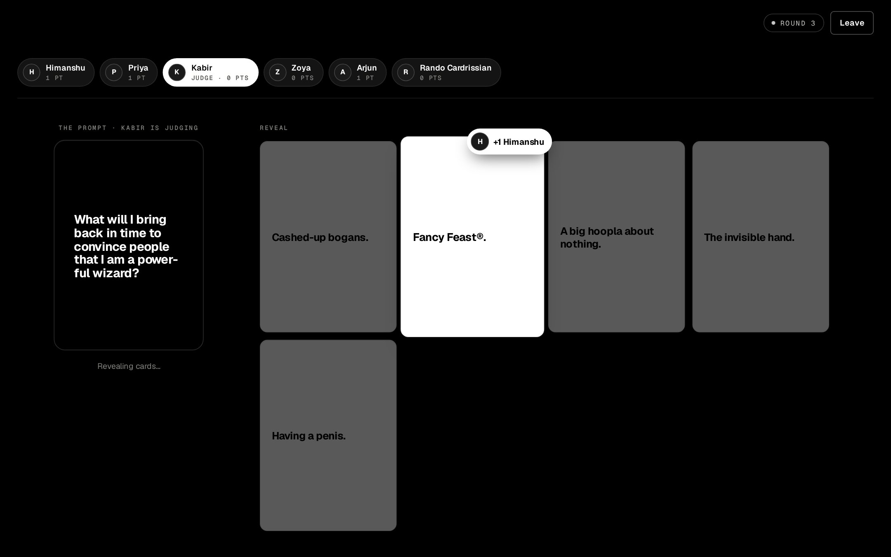
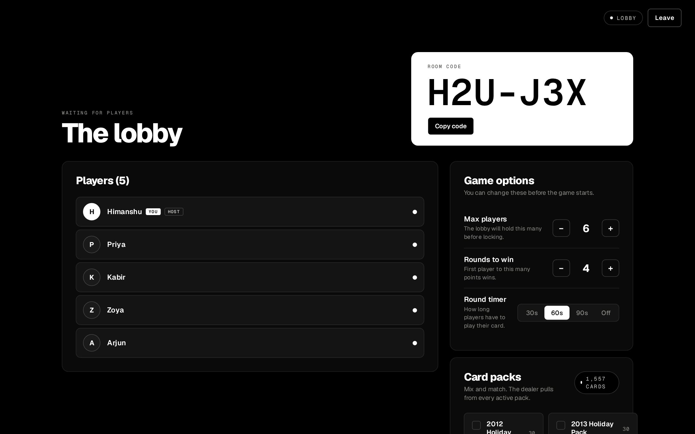
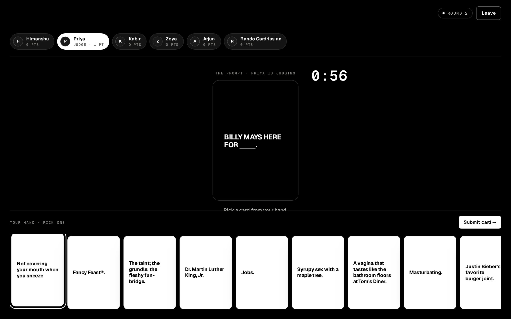
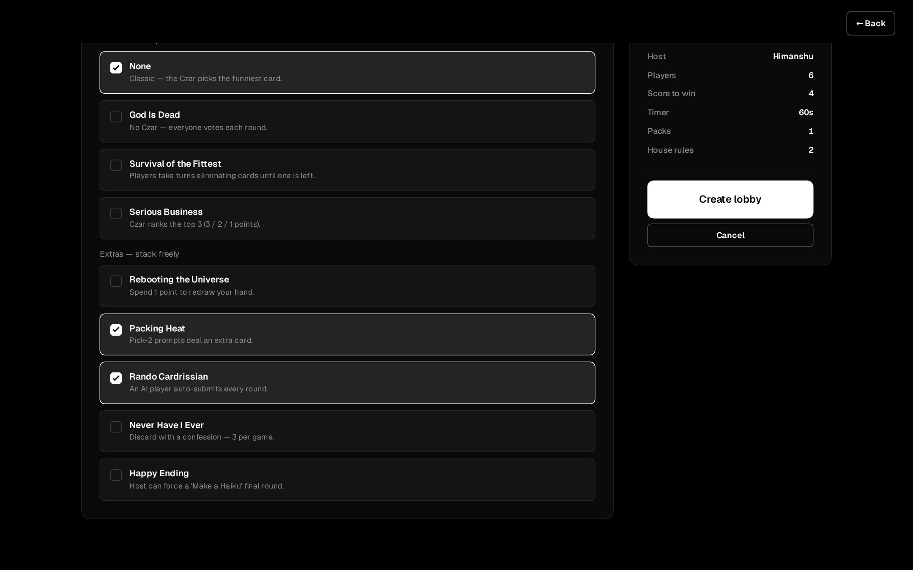
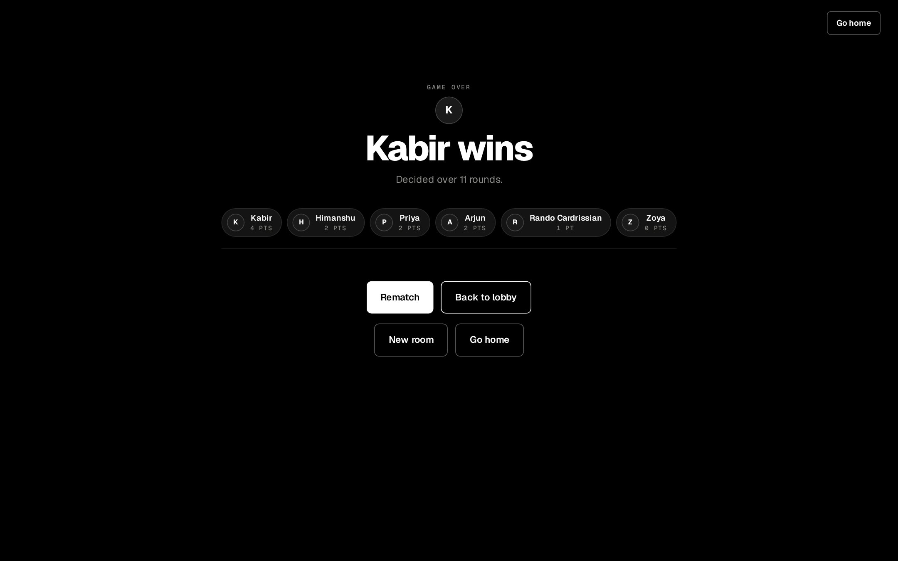
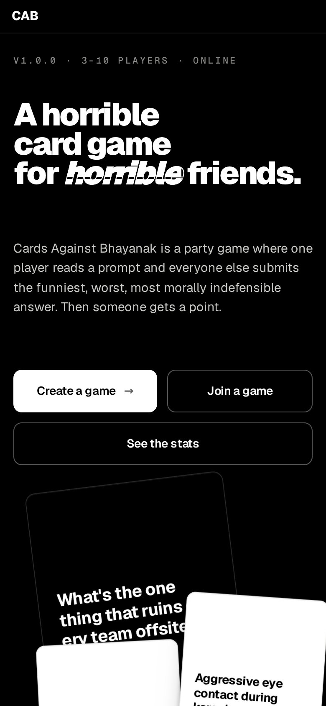
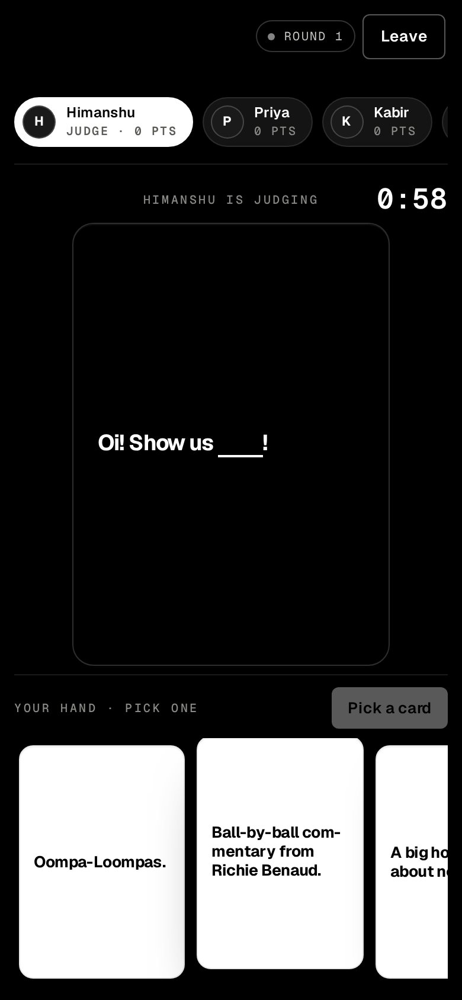

# Cards Against Bhayanak

**A horrible card game for horrible friends.**

One person reads a black card. Everyone else plays the worst white card they're holding. The Card Czar picks a favourite, someone gets an Awesome Point, and your group chat never looks at you the same way again.

No downloads. No accounts. No "wait, which app is it?" Make a room, share the six-character code, and start ruining friendships in under a minute.

👉 **[Deal a hand at cards.bhayanak.net](https://cards.bhayanak.net)**

---

## Why Cards Against Bhayanak?

### 🃏 The real deck. All of it.

More than **70 packs and over 5,000 cards**, including the base set, the expansions, the holiday packs, and a few you'll be sorry you turned on. Mix and match whatever packs you like. The dealer will happily serve "Dead parents." to your mum.

### 🚪 Get in like it's Jackbox

The host makes a room and reads out a code like `H2U-J3X`. Everyone else types it in, picks a handle, and they're in. Nobody makes a password. Nobody verifies an email. Nobody downloads anything "just for tonight".

### 🖐️ A hand you'll want to hide from your boss

You hold ten cards. Tap the one that hurts, or two or three of them in order when the prompt asks for more, and hit submit. Everyone plays in secret. The answers flip face up one at a time, without names, so the Czar can't play favourites. They'll still play favourites.

### 📜 Every official house rule, already printed out

All eight house rules from the official rulebook are built in, so nobody has to remember them and nobody gets to make up "it's my house" rules halfway through.

- **Rebooting the Universe:** pay a point to throw out your whole hand and draw a new one.
- **Packing Heat:** draw an extra card when the prompt says pick two.
- **Rando Cardrissian:** an imaginary player who plays random cards every round. If Rando wins, everybody goes home in a state of everlasting shame.
- **God Is Dead:** there is no Czar. The table votes.
- **Survival of the Fittest:** take turns killing off answers until only one is left.
- **Serious Business:** the Czar ranks the top three for 3, 2 and 1 points.
- **Never Have I Ever:** throw away a card you don't understand, three times a game. Confessing your ignorance out loud is on the honour system.
- **Happy Ending:** the host calls last orders and everyone plays one final "Make a haiku."

Mix the extras freely. The Czar-replacing ones (God Is Dead, Survival, Serious Business) don't mix, because chaos needs _some_ structure.

### 🎲 Gamble on your own terrible taste

Not sure your answer will land? Bet one Awesome Point to play a second one. If either wins, you keep the point. If both bomb, the point goes to whoever beat you.

### ⏱️ A timer for that one friend

Give everyone 30, 60 or 90 seconds to play a card, or switch the timer off if your crew enjoys watching someone agonise. Whoever runs out of time sits the round out. First to 3, or as many as 20, Awesome Points wins.

### 📶 Drops don't kill the round

Phone died? Tab closed? Wi-Fi gave up? You have 30 seconds to come back, and you'll get the same seat and the same hand. Showed up late? Join halfway through and you'll be dealt in next round. Want to just watch? Come in as a spectator and judge silently, like you always do.

### 🏆 Somebody wins. Everybody loses.

Crown a winner, then hit **Rematch** to run it back with the same people or **Back to lobby** to change the settings. The public stats page keeps count of every game, every round and every Rando victory, so the shame lasts.

### 🖤 Black and white, like the box

Strict black-and-white design, big chunky type, and cards that look like cards. It's built for a laptop on a coffee table or a phone in a sweaty hand.

### 🔗 Links that look good in Discord

Paste a room link into Discord, WhatsApp, Slack or X and it unfurls into a proper invite card. The preview never shows your room code or anyone's handle, so posting a link doesn't leak who's playing.

---

## Plays on whatever you're holding

Desktop browser, tablet, phone: if it has a browser, it can deal. On a phone, your hand scrolls along the bottom of the screen, so you can play from the couch, the bus, or a family dinner you should really be paying attention to.

  
  &nbsp;&nbsp;
  

---

## How it works

1. **Create a game.** Pick your packs, house rules, timer, and how many points it takes to win.
2. **Share the code.** Up to 10 people can join. You need at least 3, and friends are optional.
3. **Be awful.** Play cards, judge cards, regret cards.

That's the whole game. The rest is on you.

---

  <b>Ready to find out who your friends really are?</b> 
  <a href="https://cards.bhayanak.net">cards.bhayanak.net</a>

Card text comes from <a href="https://www.cardsagainsthumanity.com/">Cards Against Humanity</a>, released under <a href="https://creativecommons.org/licenses/by-nc-sa/2.0/">CC BY-NC-SA 2.0</a> and served through <a href="https://restagainsthumanity.com/">REST Against Humanity</a>. Cards Against Bhayanak is a free, non-commercial fan project and isn't affiliated with or endorsed by Cards Against Humanity LLC. Running it yourself? See <a href="docs/development.md">development and operations</a>.
